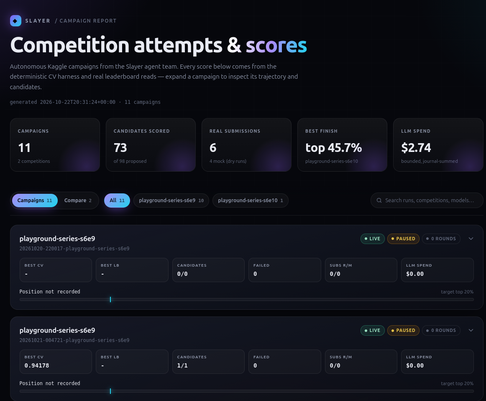
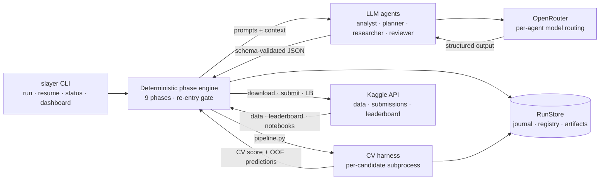
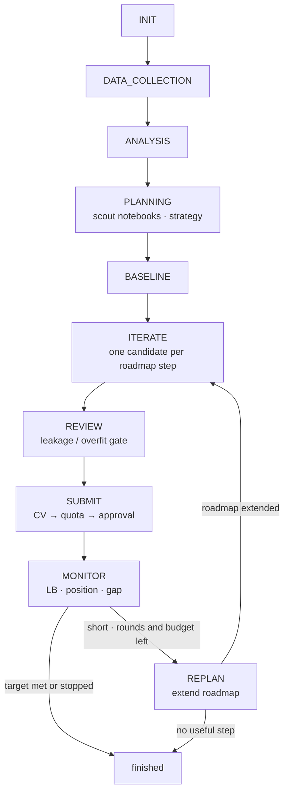
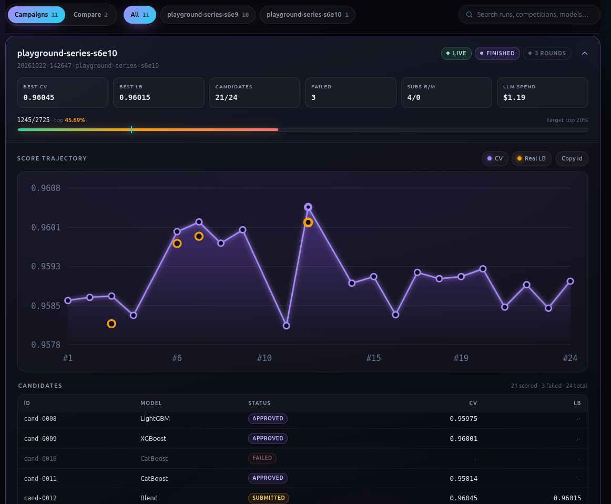

# kaggle-slayer

**A CLI that runs a team of LLM agents through Kaggle tabular competitions end to end:**
download data → analyze it → scout the top public notebooks → plan → write and
cross-validate model pipelines → review → submit (gated) → read the leaderboard back →
re-plan when short of the target.

> **v1.0 status:** live-proven on two Playground competitions. Slayer reliably produces
> valid, reviewed, gated submissions with bounded cost; the **top-20% goal is not
> reached yet**. Honest details: [Limitations & known gaps](docs/limitations.md).

**Design principle:** LLM judgment rides on deterministic scaffolding. Agents propose
ideas and write pipeline code; *code* computes every score, owns every gate, and
journals every event.

**Jump to:** [Why Slayer](#why-it-is-different) · [Results](#what-it-achieves-honestly) ·
[Quickstart](#quickstart) · [Architecture](#architecture) · [Observability](#observability) ·
[FAQ](#faq) · [Documentation](#documentation)



*The interactive report: aggregate stats, campaign filters, expandable runs, and the
head-to-head comparison view. Open the checked-in example:* [`report.html`](report.html).

## Why it is different

- **Scores are real.** Only the deterministic CV harness can score a candidate; an LLM
  can never claim a number. Submitted models are re-scored on the real leaderboard.
- **Gates are code-owned.** Every submission passes CV-improvement → quota → human
  approval (unless you explicitly opt into `agentic`). Mock submissions are the default.
- **Everything is auditable.** Every state change is an append-only journal event; the
  SQLite registry is a rebuildable view over that journal.
- **Runs are resumable.** Ctrl+C pauses safely; `slayer resume` continues from the same
  phase, budget, and history — typically once a day for fresh Kaggle quota.
- **Costs are bounded.** A per-run LLM budget, daily submission cap, and harness timeout
  are enforced by code, not by prompt discipline.

## What it achieves (honestly)

- `playground-series-s6e10` (live campaign, untouched config): 4 real submissions,
  2 re-entry rounds, **LB 0.96015 ≈ top 45.7%** (live rank moves), for about $1 of LLM
  spend. Gains came from OOF blends.
- `playground-series-s6e9`: first real LB ≈ top 71%; best CV after the evidence-driven
  changes ≈ top 45% (CV-estimated).
- Live-validated on binary classification with ROC AUC. Regression, multiclass, and the
  other registry metrics are unit-tested only.
- **The top-20% goal is not reached** — see [Why](docs/limitations.md#1-results--the-top-20-goal-is-not-achieved)
  and the ranked [improvement opportunities](docs/limitations.md#8-improvement-opportunities-analysed-not-implemented).

## Quickstart

| Need | Why |
|---|---|
| Linux or macOS, Python ≥ 3.12 | runtime |
| [`uv`](https://docs.astral.sh/uv/) | installs and runs everything |
| An OpenRouter account **with credits** | the agents' models (typically ≈ $1/campaign) |
| A Kaggle account with a verified phone | data access and submissions |
| A Kaggle API token | programmatic data, submissions, leaderboard |
| ~1 GB disk + CPU | data and local model training |

```bash
uv sync
cp .env.example .env              # fill OPENROUTER_API_KEY and KAGGLE_API_TOKEN
uv run slayer init                # checks config, secrets, and both APIs
```

**New here? Follow the step-by-step [Operator Guide](docs/guide.md)** — setup, first dry
run, live campaign, daily resumes, reading results.

## A typical campaign

```bash
uv run slayer competitions                         # browse active competitions
# accept the rules once in the browser: https://www.kaggle.com/competitions/<ref>/rules
uv run slayer run <ref>                            # dry run first (mock submissions)
uv run slayer run <ref> --live                     # real submissions; asks y/n for each
uv run slayer status <run_id>                      # progress, spend, rounds, candidates
uv run slayer dashboard --html report.html         # all attempts & scores (+ HTML report)
uv run slayer resume <run_id>                      # continue (e.g. once a day for fresh quota)
```

A pass takes minutes to about an hour depending on data size and the CV budget. Each
extra re-entry round costs roughly $0.40 and an hour of compute. Ctrl+C pauses safely;
`resume` continues where it stopped.

## Architecture

Slayer separates **deterministic control** (phases, gates, scoring, state) from **LLM
judgment** (analysis, strategy, pipeline code, review). Agents never touch raw data
directly, never compute their own scores, and never submit without passing code gates.



### Campaign workflow



ITERATE runs review + submit after each scored candidate; the standalone REVIEW/SUBMIT
phases handle the remaining best candidate. Re-entry is a deterministic gate, not an LLM
decision: target unmet, rounds/budget left, deadline allows, and the planner has not
stopped. Deep dive: [The run loop](docs/loop.md).

### The team

| Agent | Job | Output |
|---|---|---|
| **Data analyst** | interprets the deterministic data profile | `DataReport`, `FeaturePlan` |
| **Planner** | picks the CV protocol, roadmap, and hard guidance; extends the roadmap on re-entry | `StrategyPlan`, `RoadmapExtension` |
| **ML researcher** | writes each candidate's `pipeline.py` from the strategy + feedback | `PipelineProposal` |
| **Reviewer** | adversarial gate for leakage, fit-on-test, metric mishandling | `ReviewVerdict` (approve/reject/revise) |
| **Orchestrator** | reserved for the Phase 5 agentic upgrade | — |

Model routing is per-agent in [`config/agents.yaml`](config/agents.yaml). The researcher
is the highest-leverage model; how agents *choose* ideas matters more than model tier.

### What lands on disk

```text
runs/<run_id>/
├── run.json            # status + config snapshot
├── journal.jsonl       # append-only source of truth (events, costs, verdicts)
├── experiments.db      # SQLite candidate registry (rebuildable from the journal)
└── workspace/
    ├── data/           # competition CSVs + sha256 manifest
    ├── eda/            # deterministic profile.json / profile.md
    ├── external/       # public datasets + sources manifest (when enabled)
    ├── models/<cand>/  # pipeline.py, CV results, submission, OOF predictions, logs
    └── reports/        # strategy, roadmaps, notebook digest, leaderboard snapshot
```

### A real run in this repository

One complete campaign is checked in at
[`runs/20261022-142647-playground-series-s6e10/`](runs/20261022-142647-playground-series-s6e10/)
— the same s6e10 run cited above (4 live submissions, **LB 0.96015 ≈ top 45.7%**).
It includes the config snapshot, append-only journal, EDA profile, strategy and roadmap
reports, external-data manifest, and every candidate's `pipeline.py`, CV results, and
logs. Raw competition data, external CSVs, submissions, OOF/fold arrays, and duplicate
zips are excluded (≈0.5 MB checked in instead of 416 MB). Other runs remain gitignored.

### Safety and guarantees

| Guarantee | How |
|---|---|
| **Scores come from code** | The CV harness runs each pipeline in a per-candidate subprocess and records fold scores; no LLM number is trusted |
| **No accidental submissions** | `dry_run: true` by default; real submissions need `--live` **and** a y/n approval (unless `--autonomy agentic`) |
| **Quota respected** | Real submissions counted from the journal against `submissions_per_day` per UTC day |
| **Budget respected** | Cumulative LLM spend summed from the journal (survives resumes) and checked before every proposal |
| **Interruptible** | Ctrl+C pauses and kills the training subprocess; resume skips completed work |
| **Untrusted text stays untrusted** | Public-notebook digests are built by code, never executed, and framed to the planner as evidence, not instructions |
| **Secrets stay local** | Keys live only in `.env` (gitignored) and are never printed |

The harness is an isolated subprocess with a timeout and process-group kill — **not a
container**. LLM-generated code runs in the project venv; review is the main defense.
External data is enabled automatically only for Playground competitions (check other
competitions' rules yourself).

## Observability

```bash
uv run slayer status <run_id>          # phases, LLM spend vs budget, rounds, candidates
uv run slayer journal <run_id> -l 40   # last 40 events (verdicts, submissions, decisions)
uv run slayer leaderboard <ref>        # top 10 + our position
uv run slayer dashboard                # every run: attempts, scores, position, spend
uv run slayer dashboard --html report.html
```

The HTML report is a self-contained dark-mode page: aggregate stats, competition
filters, expandable run cards, hoverable score charts, sortable candidate tables, and a
head-to-head comparison across competitions. Open the checked-in example:
[`report.html`](report.html).



*Expanded campaign: CV/LB trajectory with hover tooltips and series toggles, plus a
sortable candidate table.*

## Challenge bonus features

| Bonus feature | Where it lives |
|---|---|
| Agent that reviews the leaderboard and proposes a new plan | MONITOR reads the real leaderboard and computes the gap to the target line; the re-entry gate decides; **REPLAN** has the planner write a new roadmap from the full history, the gap, and the top public notebooks (`loop/campaign.py`, design 13) |
| Dashboard reporting competition attempts and scores | `slayer dashboard`: terminal table of every run plus a self-contained interactive HTML report with per-run charts and cross-competition comparison (`dashboard.py`) |

Beyond the brief: public-notebook scout (design 15), OOF hill-climb blender (design 14),
external data (D0009), paired-fold submission gate, and budget/quota/approval gates.

## Safety defaults

| Default | Meaning |
|---|---|
| `dry_run: true` | submissions are simulated unless you pass `--live` |
| `autonomy: approve-first` | every real submission needs your y/n (`agentic` skips it) |
| `submissions_per_day: 4` | daily cap, counted from the journal |
| `budget_usd: 10` | LLM spend cap per run, cumulative across resumes |
| `max_rounds: 2` | re-entry rounds when short of the target |
| `external_data: auto` | public Kaggle datasets from top notebooks, Playground only (check other competitions' rules) |

## Limitations at a glance

- **Results:** top-20% is best effort, not a promise; the strongest public notebooks use
  deep-learning tabular models and stacks that are out of scope on laptop hardware.
- **Scope:** tabular `train.csv` / `test.csv` / `sample_submission.csv` competitions
  only; binary AUC is the only problem type live-validated.
- **Reproducibility:** LLM proposals differ between runs; code gates and scores are
  deterministic, the ideas are not.
- **Isolation:** the harness is a subprocess, not a container; the reviewer is an LLM
  and can miss subtle leakage.
- **Single process:** daemon, `attach`, and chat-driven steering are Phase 5.

Full inventory and fix paths: [Limitations & known gaps](docs/limitations.md).

## FAQ

### Does Slayer submit to Kaggle automatically?
Not unless you ask it to. `dry_run: true` is the default, so submissions are simulated.
Real submissions need `--live`, and the default `approve-first` mode asks y/n for each
one. `--autonomy agentic` removes the prompt — use it deliberately.

### Do I have to accept the competition rules?
Yes, once, in the browser. Kaggle has no API for this; INIT stops with the exact URL if
the rules are not accepted.

### How much does a campaign cost and how long does it take?
Typically about $1 of LLM spend per campaign (the hard cap is `budget_usd: 10`). A pass
takes minutes to roughly an hour depending on data size and the CV budget; an extra
re-entry round is about $0.40 and an hour of local compute. Training uses local CPU/RAM.

### Can I stop it and continue later?
Yes. Ctrl+C pauses the run and kills the training subprocess; `slayer resume <run_id>`
continues from the same phase, history, and spend. After a hard kill, stop an orphaned
harness with `pkill -9 -f slayer.cv.harness`.

### Which competitions work?
Tabular competitions with `train.csv`, `test.csv`, and `sample_submission.csv`.
Binary classification with ROC AUC is live-validated; regression, multiclass, and the
other registry metrics are unit-tested only. Image, text, time-series, multi-file, and
code competitions are unsupported. Deep learning is out of scope (D0010).

### Is LLM-generated code sandboxed?
It runs in a per-candidate subprocess of the project venv with a timeout and
process-group kill — not a container. The reviewer gates code before submission, and
public-notebook text is treated as untrusted evidence, never instructions. Run Slayer
on a machine where you are comfortable executing model code.

### Why is the top-20% goal not reached?
The strongest public notebooks combine the competition's original dataset,
deep-learning tabular models for ensemble diversity, and large stacks. Slayer supports
original external data and OOF blending, but deep learning is out of scope on laptop
hardware. It is a general system spending about an hour and a dollar per campaign — treat
leaderboard percentile as best effort. Details: [Limitations](docs/limitations.md).

### Where are results and logs?
`slayer status`, `slayer journal`, and `slayer leaderboard` show progress;
`slayer dashboard --html report.html` renders the full report. Raw artifacts live in
`runs/<run_id>/`: `journal.jsonl` is the source of truth, `experiments.db` is the
candidate registry, and `workspace/` holds data, CV results, and models.

### Does it run on Windows?
The runbook targets Linux and macOS. Windows is not validated.

## Documentation

| Document | What it covers |
|---|---|
| [Operator Guide](docs/guide.md) | step-by-step runbook: setup, dry run, live campaign, daily resumes, results |
| [Architecture](docs/architecture.md) | components, data flow, agents, safety model |
| [The run loop](docs/loop.md) | every phase, gate, skip predicate, event, and resume rule |
| [Usage](docs/usage.md) | commands, configuration, troubleshooting |
| [Limitations](docs/limitations.md) | honest gaps and ranked improvement opportunities |
| [Project status](docs/plan/PROJECT-STATUS.md) | where things stand and what to do next |
| [`docs/plan/`](docs/plan/README.md) | decisions (ADRs), designs, questions, direction changes |

## Development

```bash
uv sync
uv run pytest -q        # unit tests (integration tests are env-gated)
uv run ruff check .
```

The codebase is small and layered: `src/slayer/cli/` (typer app), `loop/` (phase
machine + re-entry), `agents/` (prompt + schema + journaling), `cv/` (metric registry,
harness, blender), `workspace/` (run store, journal, registry), `analysis/` (profiler,
notebook scout), `kaggle/` and `llm/` (thin clients), `schemas/` (pydantic contracts),
`submissions.py` (mock/real sinks), and `dashboard.py` (terminal + HTML reporting).
